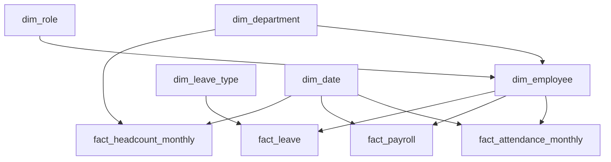

# PulseIQ Database ER Diagram

## 1. Dimension Tables

- `dim_department` — Department details
- `dim_employee` — Employee details
- `dim_role` — Employee role details
- `dim_date` — Date and calendar details
- `dim_leave_type` — Leave category details

## 2. Fact Tables

- `fact_attendance_monthly` — Monthly attendance records
- `fact_payroll` — Employee payroll records
- `fact_leave` — Employee leave requests
- `fact_headcount_monthly` — Monthly headcount records

## 3. Logical Table Relationships

- `dim_department` → `dim_employee`
- `dim_role` → `dim_employee`
- `dim_employee` → `fact_attendance_monthly`
- `dim_employee` → `fact_payroll`
- `dim_employee` → `fact_leave`
- `dim_leave_type` → `fact_leave`
- `dim_department` → `fact_headcount_monthly`
- `dim_date` → `fact_attendance_monthly`
- `dim_date` → `fact_payroll`
- `dim_date` → `fact_headcount_monthly`

## 4. Visual ER Diagram

## 5. Notes

- Dimension tables provide descriptive information.
- Fact tables store business transactions and measurements.
- The diagram shows logical relationships for documentation.
- Verify actual database keys before confirming foreign-key relationships.
- This is a partial ER diagram, not a representation of all 29 tables in the PulseIQ dataset.
