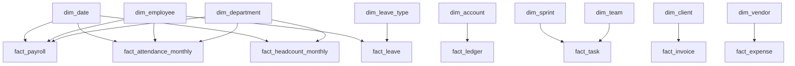

# PulseIQ Analytics Warehouse — ER Diagram

## 1. Overview

The PulseIQ analytics warehouse is stored in PostgreSQL under the `dw` schema. It contains 29 tables covering business dimensions, facts, reference data, data quality, and metrics.

## 2. Dimension Tables

- `dim_department` — Department details
- `dim_employee` — Employee dimension; `employee_key` uniquely identifies each dimension record
- `dim_role` — Employee role details
- `dim_date` — Date and calendar details
- `dim_leave_type` — Leave category details
- `dim_location` — Work location details
- `dim_account` — Account details
- `dim_client` — Client details
- `dim_sprint` — Sprint details
- `dim_team` — Team details
- `dim_vendor` — Vendor details

## 3. Fact Tables

- `fact_attendance_monthly` — Monthly attendance records
- `fact_payroll` — Employee payroll records
- `fact_leave` — Employee leave requests
- `fact_headcount_monthly` — Monthly headcount records
- `fact_task` — Task records
- `fact_ledger` — Ledger entries
- `fact_invoice` — Invoice records
- `fact_invoice_payment` — Invoice payment records
- `fact_expense` — Expense records
- `fact_forecast` — Forecast records
- `fact_anomaly` — Anomaly scoring results
- `fact_attrition_risk` — Employee attrition risk records

## 4. Verified Relationship Overview

The warehouse has 17 foreign-key constraints. Verified relationship families include:

- `dim_employee.employee_key` → employee-related fact tables
- `dim_department.department_id` → applicable department-based fact tables
- `dim_date.date_key` → applicable date-based fact tables
- `dim_leave_type.leave_type_code` → `fact_leave.leave_type_code`
- `dim_account.account_code` → `fact_ledger.account_code`
- `dim_sprint.sprint_id` → `fact_task.sprint_id`
- `dim_team.team_id` → `fact_task.team_id`
- `dim_vendor.vendor_id` → `fact_expense.vendor_id`
- `dim_client.client_id` → `fact_invoice.client_id`

## 5. Mermaid ER Diagram

## 6. Database Verification

- Tables in `dw`: 29
- Primary-key constraints: 26
- Foreign-key constraints: 17
- Check constraints: 29
- Indexes: 36
- Payroll records: 7,338

The payroll reference totals for `PR-2025-04` and `PR-2026-09` matched the expected values during verification.

## 7. Known Data-Quality Issue

One payment record references invoice `INV-00385`, which does not exist in `fact_invoice`. The foreign key for this relationship was therefore not created. Investigate the source data before correcting this mismatch; do not delete the record without review.

## 8. Notes

- Dimension tables provide descriptive information.
- Fact tables store transactions and measurements.
- This diagram is a high-level overview, not a complete visualisation of all 29 tables.
- Database constraints and row counts were checked against the loaded PostgreSQL warehouse.
